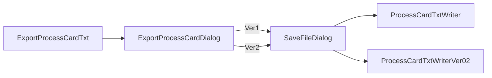

# 导出工艺卡双模板选择

## 定稿决策

- **选型 UI**：扩展现有 [`ExportProcessCardDialog`](src/AutoScrew.Hmi/Views/ControllerDevice/ExportProcessCardDialog.xaml)（不另开第二弹框），在螺钉 PN / 槽位下方增加「模板版本」单选：
  - **版本 1**：旧键值格式（现有 `ProcessCardTxtWriter`）
  - **版本 2**：ver02 `区｜段｜字段｜【值】`
- **默认**：选中 **版本 1**，保证未改习惯的用户点确定后行为与现网一致。
- **解析**：已实现双格式读入，本期只补 **写出 ver02** + 对话框接线。

## 实现步骤

### 1. ver02 写出器

新建 [`ProcessCardTxtWriterVer02.cs`](src/AutoScrew.Infrastructure/ProcessLibrary/ProcessCardTxtWriterVer02.cs)：

- `Format(template, screwPn, slotId)` / `WriteFile(...)`
- 头：`PN【】`、`版本号【00】`（固定占位或写死 00）、`拧紧参数后缀【slot:D2】`、`ID【】` 空
- 全局行对齐协议模板字段（供料延时、最终电流判定、最大/最小总角度、拧紧/拧松启动延时等）
- 四段（按策略已配置槽，与现 Writer `ResolveStageIndicesToWrite` 同逻辑，可抽小工具或复制最小集合）：启动/旋入/预紧/拧紧
- 扭矩仍显示 **lbf.in**（`TorqueUnitConverter.MilliNmToDisplay`），与读入语义一致
- 同名「进阶设定」带行尾中英文注释，保证可被 [`ProcessCardVer02Parser`](src/AutoScrew.Infrastructure/ProcessLibrary/ProcessCardVer02Parser.cs) 消歧回读
- 设定模式：写出数字枚举 0–4（与 Parser 数字解析一致）
- 拧松：第一/二阶段角度速度、生产履历、最小扭矩

可选：[`ProcessCardTxtWriter`](src/AutoScrew.Infrastructure/ProcessLibrary/ProcessCardTxtWriter.cs) 增加 `Format(..., ProcessCardTemplateVersion version)` 门面转发，HMI 只调一处；或 VM 直接 `switch` 两个 Writer——采用 **VM switch + 独立 Ver02 类**，避免改坏现有 Ver1 单测签名。

### 2. 导出弹框

改 [`ExportProcessCardDialog.xaml`](src/AutoScrew.Hmi/Views/ControllerDevice/ExportProcessCardDialog.xaml) / `.xaml.cs`：

- 增加 `RadioButton` 组：`版本 1（键值）` / `版本 2（表格式）`
- `TryPrompt` 增加 `out ProcessCardTemplateVersion version`（枚举放 Infrastructure 或 Hmi，建议 `AutoScrew.Infrastructure.ProcessLibrary.ProcessCardTemplateVersion { Ver1=1, Ver2=2 }`）
- 双语：[`Strings.zh-CN.xaml`](src/AutoScrew.Hmi/Themes/Strings.zh-CN.xaml) / [`Strings.en-US.xaml`](src/AutoScrew.Hmi/Themes/Strings.en-US.xaml) 增加版本标签与 hint 一句

### 3. ViewModel 接线

[`ControllerParameterViewModel.ExportProcessCardTxtAsync`](src/AutoScrew.Hmi/ViewModels/ControllerParameterViewModel.cs)：

- 接收 `version`；`Ver1` → 现有 `ProcessCardTxtWriter.WriteFile`；`Ver2` → `ProcessCardTxtWriterVer02.WriteFile`
- 审计串带上 `template=Ver1|Ver2`

### 4. 测试

- Ver02：`Format` → `ProcessCardTxtParser.Parse` 往返，断言 PN/槽位、全局角度、至少启动角/拧紧扭矩、拧松一段
- 现有 [`ProcessCardTxtWriterTests`](tests/AutoScrew.Tests/ProcessCardTxtWriterTests.cs) 不变

## 验收

- 导出弹框可选版本；默认 Ver1 导出仍为旧 TXT
- 选 Ver2 导出的文件可再上传工艺库并解析成功
