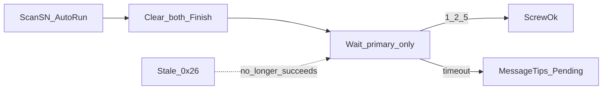

# 修复假 Finish 导致第1钉误绿（V1.0 热修）

## 根因（已确认）

挂起健壮性把 [`TighteningCycleRunner.WaitFinishAsync`](src/UDL.Delta.IemdSd/Internal/TighteningCycleRunner.cs) 改成双读 OR：残留 `0x26=1` 在默认非 legacy 配置下会立刻当完成 → AutoRun 扫 SN 后第1钉变绿 → 清标志后第2钉真等满 120s 弹「运行异常」。

厂商 Demo 是**读单址**；双清应在等之前/之后做，而不是用副址单独判成功。

## 固定修法（不做其它选项）

1. **收回双读成功语义**：仅主址（`UseLegacyFinishRegister` 决定 `0x26` 或 `0x1F5D`）为 `1|2|5` 才返回；副址只用于 Debug/超时文案。
2. **等 Finish 前双清**：`RunCoreAsync` 在进入 `WaitFinishAsync` 之前调用现有 `ClearFinishAsync`（两址写 0）。
3. **Init 双清**：[`IemdSdClient.InitializeCoreAsync`](src/UDL.Delta.IemdSd/IemdSdClient.cs) 无论 legacy 与否都清 `0x1F5D` 与 `0x26`。
4. **保留**：超时异常文案含两址末值；HMI `MessageTips`；`OperatorSession` 非取消异常回 Pending / Stop 强制清门闩。

不改：AutoRun 产品策略、默认 120s、MES、工艺卡格式。

## 代码改动

### [`TighteningCycleRunner.cs`](src/UDL.Delta.IemdSd/Internal/TighteningCycleRunner.cs)

- `RunCoreAsync`：在 `WaitFinishAsync` 前 `await ClearFinishAsync(...)`（DI 路径则在 DI ack 之后、WaitFinish 之前清，避免清掉尚未开始的周期；Manual 则一进入周期就清）。
- `WaitFinishAsync`：循环内仍可读副址打 Debug；**仅** `IsFinishValue(lastPrimary)` 时返回；去掉 secondaryHit 成功分支与冲突取主逻辑（不再需要）。
- `ClearFinishAsync`：保持双写 0。

### [`IemdSdClient.cs`](src/UDL.Delta.IemdSd/IemdSdClient.cs)

- `InitializeCoreAsync`：替换「仅非 legacy 清 0x1F5D」为两址都写 0。

### 测试 [`TighteningCycleTimeoutTests.cs`](tests/UDL.Delta.IemdSd.Tests/TighteningCycleTimeoutTests.cs)

- **删除或改写** `WaitFinish_SucceedsWhenOnlyLegacyRegisterFinishes`：非 legacy 时仅 `0x26=1` 必须**不能**成功（超时或清后仍超时）。
- 新增：`StaleLegacyFinish_DoesNotInstantOk_WhenPrimaryPreferred` — transport 初始 Legacy=1、Finish=0；Run 后不得在短超时内返回 Ok（断言抛超时）；并断言启动时发生了对两址的 clear 写。
- 保留：主址命中成功、超时文案含两址、Busy 用例。
- 改写冲突用例：副址不同值且主址有效 → 仍以主址为准；仅副址有效 → 超时。

跑：`dotnet test` 过滤 `TighteningCycleTimeoutTests` + `OperatorSessionCycleRobustnessTests`（确认回 Pending 未回退）。

## 验收

- 扫 SN 后未扣扳机：第1钉保持 Pending/进行中等待，不变绿。
- 真拧完：主 Finish 仍 OK/NG 正常推进。
- 超时：仍弹「运行异常」，钉位回 Pending，可再 AutoRun。
- 回归：无「仅脏 0x26 假 OK」。
