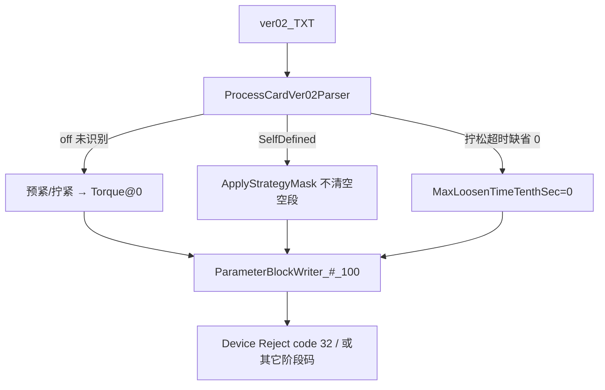

# 修复 ver02 卡 #100 下发失败

## 现场结论（已锁定）

- 失败类型：**B** — 解析/进库成功，**写入设备 `#100` Reject**
- 证据：[1835150951.txt](1835150951.txt) + [comm-20261110.log](comm-20261110.log)

```text
COMM Command #100 … Rejected DeviceErrorCode=32
Describe=基本设定：设定拧紧/拧松超时大于 32767。
```

该卡关键字段：

- `策略｜【自创】`，仅启动段有速度/角度；旋入模式 `0` 但目标全 0
- 预紧/拧紧 `设定模式｜【off】`（**当前解析不认 off**）
- `超时｜【1】` → 按秒×10 得拧紧超时=10；**拧松超时未填 → Core=0**
- 扭矩格多为 0（本次 code 32 **不是** lbf.in×113 溢出直接导致；单位问题留作填满扭矩卡的后续项）

## 根因（代码）



1. **`设定模式【off】`**：[`TryParseControlMode`](src/AutoScrew.Infrastructure/ProcessLibrary/ProcessCardSemantics.cs) 对 `off` 返回 null → [`ResolveControlMode`](src/AutoScrew.Infrastructure/ProcessLibrary/ProcessCardSemantics.cs) 预紧/拧紧落到 **扭矩且目标 0**。
2. **自创掩码空操作**：[`ApplyStrategyMask`](src/UDL.Delta.IemdSd/Protocol/TighteningStrategy.cs) 对 `SelfDefined` 直接 `return`，空段带着错误模式进 349-word。
3. **超时 0 与 Demo 不一致**：SDSoft 写设备时 `MaxTightening/LoosenTime==0 → 32767`；我们写 **0**。同时缺少写前 `≤32767` 校验与 **0xE9/0xEA 实际字**日志，code 32 难复核。

## 改动方案（定稿）

### 1. ver02「关段」语义

文件：[ProcessCardSemantics.cs](src/AutoScrew.Infrastructure/ProcessLibrary/ProcessCardSemantics.cs)、[ProcessCardVer02Parser.cs](src/AutoScrew.Infrastructure/ProcessLibrary/ProcessCardVer02Parser.cs)

- `设定模式`/`控制模式` 值为 `off`/`OFF`/`关`/`关闭`/`否` → **跳过该段**（保持默认空 `TighteningStageCore`，不调用 `ResolveControlMode`）
- 数字 `0` 仍表示角度（与手册一致），**不是**关段

### 2. 自创写前清空段

文件：[TighteningStrategy.cs](src/UDL.Delta.IemdSd/Protocol/TighteningStrategy.cs) `ApplyStrategyMask`

- `SelfDefined`：对 `!IsStageConfigured(stage)` 的槽位清零为 `new TighteningStageCore()`（避免 off/空段以 Torque@0 下发）
- 已配置槽（转速/角/扭矩等非 0）保留

### 3. 超时字规范化 + 诊断

文件：[ParameterBlockWriter.cs](src/UDL.Delta.IemdSd/Internal/ParameterBlockWriter.cs)、[TighteningParameterCodec.cs](src/UDL.Delta.IemdSd/Protocol/TighteningParameterCodec.cs) 或 Writer 内写前一步

- 写块前：`MaxTighteningTimeTenthSec==0` 或 `MaxLoosenTimeTenthSec==0` → 写成 **32767**（对齐 SDSoft）
- 若任一超时字 **>32767**：本地抛清晰中文，不发 `#100`
- `COMM ParameterWrite` 增加 `MaxTighteningTimeTenthSec` / `MaxLoosenTimeTenthSec`（规范化后的值）；Reject 时再打一块内 word 对应值（便于对照 code 32）

### 4. 下发前预检（针对 ver02 常见坑）

文件：[ControllerParameterPresetService.EnsureWritableStages](src/AutoScrew.Infrastructure/Hardware/ControllerParameterPresetService.cs) 或同层新方法

在 `#100` 前检查并中文提示，例如：

- 自创下仅启动有内容时允许（清空段后）
- 活动段为扭矩/夹紧类但目标扭矩为 0 → 直接拒绝并提示改设定模式/填扭矩
- 超时规范化后仍越界 → 拒绝

### 5. 测试与样板

- 将 [1835150951.txt](1835150951.txt) 纳入 fixture（建议命名 `1835150951_10.txt` 以含槽位，或正文已有后缀【10】）
- 单测：`off` 段不被建成 Torque@0；SelfDefined 掩码清空段；超时 0→32767；解析该卡后构造 write Core 无「扭矩模式且目标 0」的活动段
- 文档：[PROCESS_LIBRARY.md](doc/PROCESS_LIBRARY.md) / [UserManul.md](doc/Help/UserManul.md) 一句：ver02 `设定模式` 填 `off` 关段；`0`=角度；超时空/0 下发为不限制(32767)

## 明确不做（本轮）

- 不改扭矩「lbf.in vs Torque L」总策略（本卡扭矩为 0，与 code 32 无直接关系）。若修完 off/超时后，**填满 2123/350 的卡仍报 18/19**，再单独开单位语义任务。
- 不改顺序卡。

## 验收

- 导入 `1835150951.txt` → 下发：不应再因预紧/拧紧 Torque@0 或超时 0 的 Demo 不一致而误伤；若设备仍拒，日志能看到规范化后的超时字与 code。
- 单测覆盖 off / SelfDefined 清段 / 超时 0→32767。
- 旧键值卡回归仍绿。
