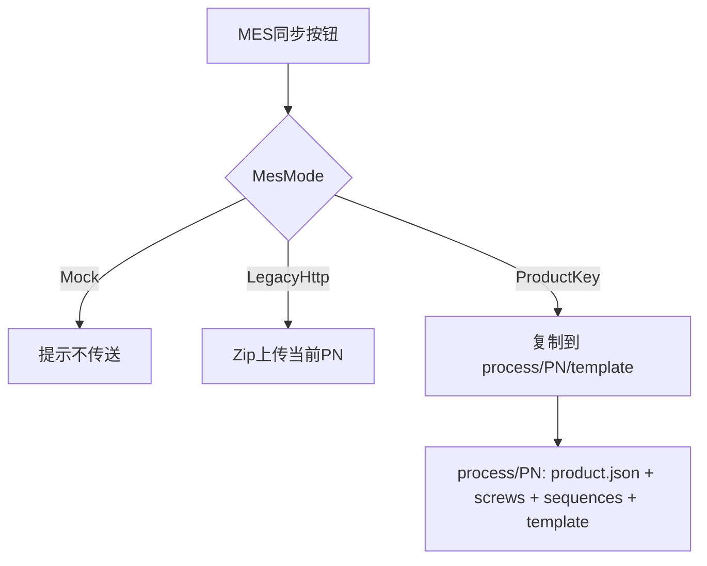

# 螺钉模板 MES 同步（按 MesMode）

## 目标行为

工具栏「MES 同步」按 [`MesProviderMode`](src/AutoScrew.Application/Abstractions/MesProviderMode.cs) 分支（当前 PN = 编辑器已打开的 `ProductId`）：

| 模式 | 行为 |
|------|------|
| `Mock` | **不传送**；状态栏提示脱机/Mock 无需同步 |
| `LegacyHttp` | 调用现有 `POST api/templates/{pn}/package` 上传当前 PN 文件夹 zip |
| `ProductKey` | 将本机 `Templates/{PN}/` 复制到 `{LanShareRoot}\process\{PN}\template\`（与 `screws/`、`sequences/` 同级） |



局域网目标树（ProductKey 发布后）：

```text
{LanShareRoot}\process\{PN}\
  product.json          # 工艺库已有
  screws\…              # 拧紧参数
  sequences\…           # 拧紧顺序
  template\             # 本次新增
    {PN}.product-template.json
    images\…
```

约定：按钮**只推送螺钉模板**；不改写 `screws/` / `sequences/`（仍由工艺库维护）。不在每次「保存」时自动同步——仅按钮触发。

## 局域网 PN 建目录规则（业务硬约束）

当 `{processRoot}/{PN}` **尚不存在**时：

| 产物 | 可否新建该 PN 文件夹 | 说明 |
|------|----------------------|------|
| 拧紧参数（`screws/` + `product.json`） | **可以** | 工艺库上传参数可创建整棵 PN |
| 螺钉模板（`template/`，MES 同步） | **可以** | ProductKey 发布模板时可创建 `process/{PN}/template/`（进而创建 PN） |
| 拧紧顺序（`sequences/`） | **不可以** | 顺序业务上依赖参数；禁止为写顺序而新建 PN |

判定（顺序写入前）：

1. `process/{PN}` 目录必须已存在；**不得**对缺失的 PN 根做 `CreateDirectory`。
2. 该 PN 须已有拧紧参数（`product.json` 中至少 1 个 slot，或 `screws/` 下已有工艺卡）。仅有 `template/`、尚无参数时，顺序上传仍应失败并提示「请先建立拧紧参数」。
3. 在已存在的 PN 下，允许创建 `sequences/` 子目录并写入顺序文件。

现状缺口：[`ProcessLibraryStore.SaveSequenceAsync`](src/AutoScrew.Infrastructure/ProcessLibrary/ProcessLibraryStore.cs) 今日会 `CreateDirectory(seqDir)`，从而顺带新建整个 PN——本次需改掉。

## 实现要点

### 1. 重写同步服务分支 — [`ProductTemplateMesSyncService`](src/AutoScrew.Application/Services/ProductTemplateMesSyncService.cs)

今日逻辑：`!UseMockMes` 直接拒绝；`UseMockMes` 才做双向 HTTP。改为按 `MesMode`：

- **Mock**：返回成功摘要「Mock 模式不传送」（uploaded/downloaded=0）。
- **LegacyHttp**：仅上传**当前 PN**（需 API 增加 `partNumber` 参数，或 VM 传入）；解开 `MesTemplateUploadService` / Package 客户端里「仅 Mock」闸门，改为允许 `LegacyHttp`（仍禁止 ProductKey 走 HTTP 包）。
- **ProductKey**：调用新的局域网发布器；`LanShareRoot` 为空则明确报错。

接口调整示例：`SyncWithMesAsync(string? partNumber, CancellationToken)` — ProductKey/LegacyHttp 要求非空 PN；Mock 可忽略。

### 2. 局域网发布 — 新服务（Infrastructure）

新增例如 `ProductTemplateLanPublisher` / `IProductTemplateLanPublisher`：

- 解析目标：`Path.Combine(ProcessLibraryStore.ResolveProcessRoot(), safePn, "template")`（复用 [`ProcessLibraryStore.ResolveProcessRoot`](src/AutoScrew.Infrastructure/ProcessLibrary/ProcessLibraryStore.cs) + [`LanShareAccess`](src/AutoScrew.Infrastructure/Lan/LanShareAccess.cs)）。
- 源：`IProductTemplateLocalStore.GetProductFolder(pn)`。
- 行为：**允许**在 PN 不存在时创建 `process/{PN}/template/`；镜像复制 JSON + `images/`（覆盖同名文件）；缺本地模板则失败并写清错误。
- 不创建、不改写 `screws/` / `sequences/`；若 PN 已由参数建好，只往其下补 `template/`。
- 失败不静默成功；成功返回目标 UNC/路径供状态栏展示。

### 2b. 拧紧顺序禁止新建 PN — [`ProcessLibraryStore.SaveSequenceAsync`](src/AutoScrew.Infrastructure/ProcessLibrary/ProcessLibraryStore.cs)

- 在写 `sequences/` 前校验 PN 已存在且已有参数（见上表）。
- 不满足则抛出明确业务异常（中文消息），HMI 工艺库上传顺序路径原样展示。
- 仅当 PN 合法存在时，才 `CreateDirectory(sequences)`。
- 参数路径 `SaveProcessCardAsync` 保持可新建 PN（现状即可，必要时补测锁定）。

### 3. 扫码可读 LAN 模板 — [`RecipeProvisioningService`](src/AutoScrew.Application/Services/RecipeProvisioningService.cs)

本地 `Templates/{PN}` 未命中时，增加回退：从 `process/{PN}/template/` 解析 `{PN}.product-template.json`（ProductKey 或已配置 `LanShareRoot` 时）。

可选增强（纳入本次）：若仅 LAN 有模板，可先复制到本机 `Templates/{PN}/` 再加载，避免作业中途 UNC 断连；与工艺换型读共享盘同一原则。

### 4. HMI — [`ProductTemplateEditorViewModel.SyncWithMesAsync`](src/AutoScrew.Hmi/ViewModels/ProductTemplateEditorViewModel.cs)

- 去掉「非 Mock 一律显示 `MesSyncNotMock`」的短路。
- 未打开/无 `ProductId` 时禁用或提示先打开产品。
- 按模式展示不同结果文案（双语键：`S.Template.MesSyncMockSkip` / `MesSyncLanOk` / `MesSyncApiOk` 等）。
- `IsMesSyncEnabled`：Mock 仍可点（给提示）；LegacyHttp/ProductKey 需有 PN；ProductKey 建议校验已配置 `LanShareRoot`（也可点按后报错）。

### 5. 文档对齐（契约先于实现习惯）

- [`doc/DATA_AND_TRACE.md`](doc/DATA_AND_TRACE.md)：产品模板 LAN 路径改为 `process/{PN}/template/`。
- [`doc/FusionTodo.md`](doc/FusionTodo.md) F-05：目标从 `{LanShareRoot}\{PN}` 改为 `process\{PN}\template\`；完成后勾选。
- [`doc/PROCESS_LIBRARY.md`](doc/PROCESS_LIBRARY.md)：增加 `template/`；写明 PN 建目录规则（参数/模板可建，顺序不可建且依赖参数）。
- 视需要改 [`doc/Help/UserManul.md`](doc/Help/UserManul.md)「MES 同步在生产不可用」表述。

### 6. 测试

- 单元：Mock 不调用 upload/LAN；LegacyHttp 对当前 PN 调 upload；ProductKey 写入 `…/process/{PN}/template/{PN}.product-template.json`（可用临时目录 mock `ResolveProcessRoot`）。
- **PN 闸门**：仅模板存在、无 screws 时 `SaveSequence` 失败；无 PN 目录时顺序失败；有参数后顺序可写；参数/模板同步可新建 PN。
- 解析：仅 LAN 有 `template/` 时 `RecipeProvisioning` 能解析到文件。
- `dotnet test` 相关用例 + 解决方案可编译。

## 明确不做

- 不通过此按钮同步/改写拧紧参数与拧紧顺序。
- 不改为保存即自动同步。
- 不引入新的 ProductKey HTTP 模板 API。
- 不把模板仍写到旧草案 `{LanShareRoot}\{PN}\`。
- 不让拧紧顺序在缺 PN / 缺参数时隐式建目录。
