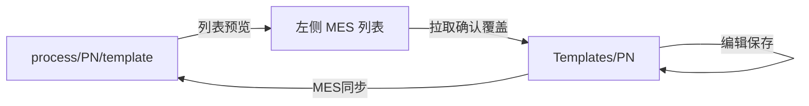

# 左侧预览局域网螺钉模板 + 拉取编辑

## 目标

在现有「预览所有本地模板」旁/下增加 **MES（局域网）模板**列表，仅 **ProductKey** 模式启用。技术员从列表**拉取**到本机 `Templates/{PN}/` 后编辑，再用现有「MES 同步」推回。

## 拉取规则（已确认）

- 数据源：`{processRoot}/{PN}/template/{PN}.product-template.json`（复用 [`ProcessLibraryStore`](src/AutoScrew.Infrastructure/ProcessLibrary/ProcessLibraryStore.cs) / [`IProductTemplateLanShare`](src/AutoScrew.Application/Abstractions/IProductTemplateLanShare.cs)）
- 本机无该 PN：直接镜像复制 LAN → 本机，并打开编辑
- 本机已有：弹确认「将用局域网版本覆盖本机 {PN}，未保存更改将丢失」→ 确认后覆盖并打开
- Mock / LegacyHttp：列表为空或隐藏区块，状态提示「仅 ProductKey 局域网可用」

权限：螺钉模板页本身已是技术员入口（[`MainShellViewModel`](src/AutoScrew.Hmi/ViewModels/MainShellViewModel.cs) 角色导航）；拉取命令不向操作员单独开放新页。

## 实现要点

### 1. 局域网枚举 API — 扩展 `IProductTemplateLanShare`

新增例如：

- `IReadOnlyList<ProductTemplateLanEntry> ListLanTemplates()`  
  扫描 `processRoot` 下各 PN：仅当 `template/{PN}.product-template.json` 存在时收录；可附带面数（读 JSON 粗算）或仅 PN。
- `Task PullToLocalAsync(string partNumber, CancellationToken)`  
  强制镜像 LAN → 本机（无论本机是否已有）；内部复用现有 `MirrorCopyDirectory` 方向（LAN→local）。

实现落在 [`ProductTemplateLanShare`](src/AutoScrew.Infrastructure/Templates/ProductTemplateLanShare.cs)；`ListProductPns` + `TryResolveLanTemplate` 即可拼列表。

### 2. HMI 左侧 UI — [`ProductTemplateEditorView.xaml`](src/AutoScrew.Hmi/Views/ProductTemplateEditorView.xaml)

在本地模板 `ListBox` 下方（或同侧再分一块）增加：

- 标题「预览 MES 模板」+ 刷新按钮
- `ListBox` 绑定 `MesTemplates`
- 「拉取」按钮（选中项可用）或双击拉取

布局：现有左栏 Row 已较挤，将本地/MES 两列表各占一半高度，或把 MES 列表放本地列表同一 Border 内上下分区。

### 3. ViewModel — [`ProductTemplateEditorViewModel`](src/AutoScrew.Hmi/ViewModels/ProductTemplateEditorViewModel.cs)

- 注入 `IProductTemplateLanShare`、`IMesSettingsService`（已有）
- `RefreshMesTemplatesCommand`：仅 `MesMode==ProductKey` 时枚举；否则清空并可选短提示
- `PullMesTemplateCommand`：
  1. dirty 先确认放弃
  2. 本机已有 → `MessageBox`/ConfirmTips 确认覆盖
  3. `PullToLocalAsync`
  4. 刷新本地列表并以该 PN 打开（复用现有打开本地模板路径）
- 初始化与「本地刷新」后顺带刷新 MES 列表（ProductKey 时）

### 4. 文案

双语键（`Strings.zh-CN.xaml` / `en-US.xaml`）：`S.Template.MesTemplates`、`Refresh`、`Pull`、`PullConfirmOverwrite`、`PullOk`、`MesListProductKeyOnly` 等。

### 5. 文档与测试

- 简述更新 [`doc/Help/UserManul.md`](doc/Help/UserManul.md) §5.4
- 单测：`ListLanTemplates` 只返回有 `template/` 的 PN；`PullToLocal` 覆盖本机内容；非 ProductKey 列表为空（VM 或 share 层测）

## 明确不做

- LegacyHttp 目录 API 列表 / Mock 假列表
- 自动双向同步；拉取后仍须手动「MES 同步」推回
- 改操作员作业台流程（扫码物化逻辑保持不变）
