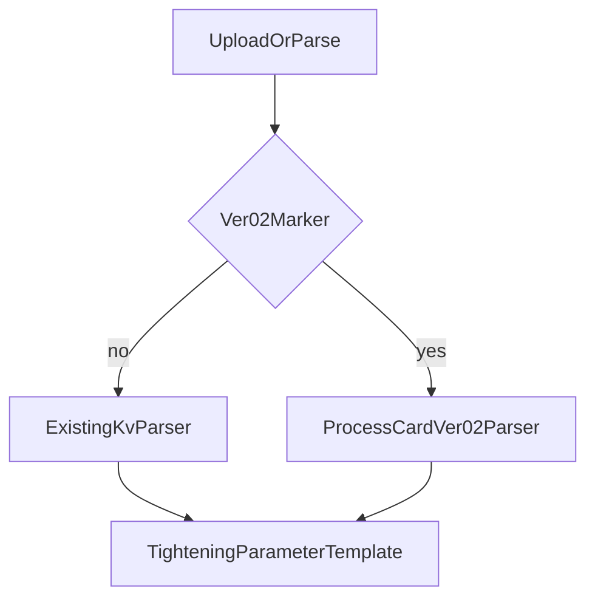

# 工艺卡 TXT ver02 双格式解析

## 定稿决策

- **双格式**：同一入口自动识别；旧夹具与现网 `screws/*.txt` 继续走现有逻辑。
- **语义不变**：扭矩/限值仍按 **lbf.in** 经现有 `TorqueUnitConverter` 转 mNm；角度、速度、延时单位与现解析器一致。
- **身份映射**（对齐旧卡含义）：
  - `PN【…】` → 螺钉 PN（`Core.Name` / `ScrewPn`）
  - `拧紧参数后缀【00|10|20】` → 槽位 `SlotId`（等同旧 `参数：PN-00`）
  - `ID【】` 忽略（设备 ParameterId 仍 `slot+1`）
  - `版本号【】` 本期只校验/日志，不改工艺库目录契约
- **写出侧本期不改**：[`ProcessCardTxtWriter`](src/AutoScrew.Infrastructure/ProcessLibrary/ProcessCardTxtWriter.cs) 继续输出旧键值格式；仅增强解析。

## 格式差异

- 旧格式：`键：值` + `1.启动` 段头（见现有 Fixtures）
- ver02：`区｜段｜字段｜【值】` + 行尾英文注释（见 [`doc/protocol/拧紧参数--模板ver02.txt`](doc/protocol/拧紧参数--模板ver02.txt)）

## 实现步骤

### 1. 入口分流

在 [`ProcessCardTxtParser.Parse`](src/AutoScrew.Infrastructure/ProcessLibrary/ProcessCardTxtParser.cs) 开头检测 ver02：

- 命中：存在 `PN【`，或数据行同时含全角 `｜` 与 `【…】`
- 命中则委托 `ProcessCardVer02Parser.Parse`；否则保持现实现
- Service/Store 契约不变（仍返回 `ProcessCardParseResult`）

### 2. ver02 行解析

新建 [`ProcessCardVer02Parser.cs`](src/AutoScrew.Infrastructure/ProcessLibrary/ProcessCardVer02Parser.cs)：

- 头信息用 `标签【值】` 提取 PN / 版本号 / 拧紧参数后缀
- 数据行按全角竖线拆分，取出括号内值并 Trim（含全角空格）
- 空括号视为未填：布尔默认关、数值默认 0；**后缀为空且文件名也无槽位则抛明确异常**
- 同段同名「进阶设定/角度」用行尾注释消歧，映射到现有内部键（加速时间、减速时间、一段扭矩取首次非空、最终速度、二段加速、一段暂停、两阶段模式、缓停止、拧紧角度、控制模式）
- 段名：启动=0、旋入=1、预紧=2、拧紧=3
- 缺省：方向顺时针；策略 `InferFromStages`；无判断开关时沿用现有限值推断
- 模板瑕疵写死策略：拧松条件超时按最大拧紧时间；拧松二段以中文字段为准；拧紧段第二行角度 0 不覆盖已解析目标角

### 3. 语义复用

- 扭矩继续 `LbfInToMilliNm`；禁止把 ver02 数字当 mNm 直写
- 设定模式空：走现有 `ResolveControlMode`
- 将现 Parser 的 `ApplyStage` / `ApplyLoosen` 抽成可共享内部方法，避免双套换算
- 解析成功后 `ApplyCoreToRaw()`

### 4. 测试与文档

- 现有 [`ProcessCardTxtParserTests`](tests/AutoScrew.Tests/ProcessCardTxtParserTests.cs) 全部保持通过
- 新增 ver02 fixture（模板拷贝并填后缀 00），断言 PN/Slot、全局角度、四段关键量、拧松一段
- 单测：空后缀失败可读；旧卡不误入 ver02
- 手册工艺库一节补一句：支持旧键值与 ver02；扭矩仍为 lbf.in；后缀即槽位

## 风险与验收

- 最大风险：现场扭矩单位若实际已是 mNm，只需改 ver02 扭矩分支
- 验收：旧/新 fixture 均可上传；换产下发与现网一致；坏卡有字段级错误而非静默 0
