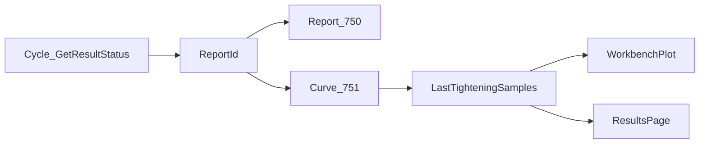

# 作业台曲线修复 + 技术员拧紧结果页

## 目标与边界

- 操作员：作业台右侧曲线在每钉周期结束后立刻画出完整曲线；可在扭矩–时间 / 扭矩–角度间切换。
- 技术员：独立导航页「拧紧结果」，展示最近一次周期结果摘要 + 同款双模式曲线。
- 不做：SDSoft TCP FSID 498/499、拧紧过程中逐点实时画图、FTP 曲线、复刻表盘像素级 UI。
- 数据路径不变：真机仍走 `ExecuteProductionTighteningAsync` → `#750` + `#751` → `TorqueAngleSample`（[IemdSdLockStationHardware.cs](src/AutoScrew.Infrastructure/Hardware/IemdSdLockStationHardware.cs)）。仿真走 [SimulatedLockStationHardware.cs](src/AutoScrew.Infrastructure/Hardware/SimulatedLockStationHardware.cs)。

## 空图根因（已确认）

| 环节 | 行为 |
|------|------|
| `#751` TotalPoints 为 0 或读异常 | [CurveReader.cs](src/UDL.Delta.IemdSd/Internal/CurveReader.cs) 返回空；[IemdSdClient.cs](src/UDL.Delta.IemdSd/IemdSdClient.cs) 设 ArtifactReadError |
| 硬件层 | [IemdSdLockStationHardware.cs](src/AutoScrew.Infrastructure/Hardware/IemdSdLockStationHardware.cs) yield break，OK/NG 仍来自 cycle |
| UI | [OperationPageView.xaml.cs](src/AutoScrew.Hmi/Views/OperationPageView.xaml.cs) 仅在 pts.Count 大于 1 时画图，否则空白无提示 |

当前 `#751` 只读 Angle+Torque；`TimeMs` 由 `ComposePoints` 用 `i * 3.0` 合成。扭矩–时间图先用该 `TimeMs`（显示为秒）。本期不扩展 Time 分块 Mode。

## 实现步骤

### 1. 共享曲线状态 + 诊断可见性

- 在 `OperatorSessionController` 增加最近一次曲线诊断只读属性（ReportId、点数、空因摘要），周期结束时写入；复位清空。
- `IemdSdLockStationHardware`：无 `#751` 点时从 LogDebug 提到 LogWarning，并把空因传到会话层（不改变 OK/NG）。
- 作业台与结果页：点数不足时显示明确文案，避免白框误判。

### 2. 抽取可切换的 ScottPlot 控件

新建 [src/AutoScrew.Hmi/Views/Controls/TighteningCurvePlotView](src/AutoScrew.Hmi/Views/Controls/)：

- 输入：`IReadOnlyList<TorqueAngleSample>` + 模式 `TorqueAngle | TorqueTime`。
- Combo：扭矩–角度 / 扭矩–时间（双语键写入 Strings.zh-CN / en-US）。
- 绘制：点数大于 1 时 Scatter；X=AngleDeg 或 TimeMs/1000，Y=TorqueNm。
- 对外 `SetSamples` / `Clear`，UI 线程刷新。

作业台 [OperationPageView](src/AutoScrew.Hmi/Views/OperationPageView.xaml) 用该控件替换手写 CurvePlotHost；仍订阅 `MainViewModel.CurveChanged` → 推送 `Session.LastTighteningSamples`。

### 3. 技术员「拧紧结果」独立页

- 新增 `TighteningResultsPage` + `TighteningResultsViewModel`。
- 挂到 [MainShellViewModel.cs](src/AutoScrew.Hmi/ViewModels/MainShellViewModel.cs) 设备配置分组；仅 Technician+ 可见。
- 页面：最近 SN/PN、最终扭矩/角度、OK/NG 摘要 + 共享曲线控件；订阅同一 `OperatorSessionController`。
- 本页只观察最近一钉结果，不做联机试打控件。

### 4. 回归与验证

- 仿真硬件：作业台与结果页均应出图，两模式可切换。
- 真机：打一钉后查 `#751` Warning；有点则双页有图，无点则文案提示且 OK/NG 正确。
- CSV 仍写入 `work/{SN}/torque_curve_*.csv`。

### 5. 文档（最小）

- [doc/Help/UserManul.md](doc/Help/UserManul.md) 技术员章节补一句拧紧结果页说明。

## 关键改动文件

- OperationPageView.xaml(.cs)
- 新建 TighteningCurvePlotView、TighteningResultsPage、TighteningResultsViewModel
- MainShellViewModel.cs（导航/权限）
- OperatorSessionController.cs（曲线诊断）
- IemdSdLockStationHardware.cs（日志/空曲线信息传递）
- Strings.*.xaml、DI 注册

## 明确不做

- 迁移 SDSoft Form400 TCP 498/499
- 拧紧中途实时曲线流
- `#751` Time 分块 Mode 扩展（除非真机验证合成时间轴不可接受后再开）
- 设备生产履历页内嵌 #751 图
