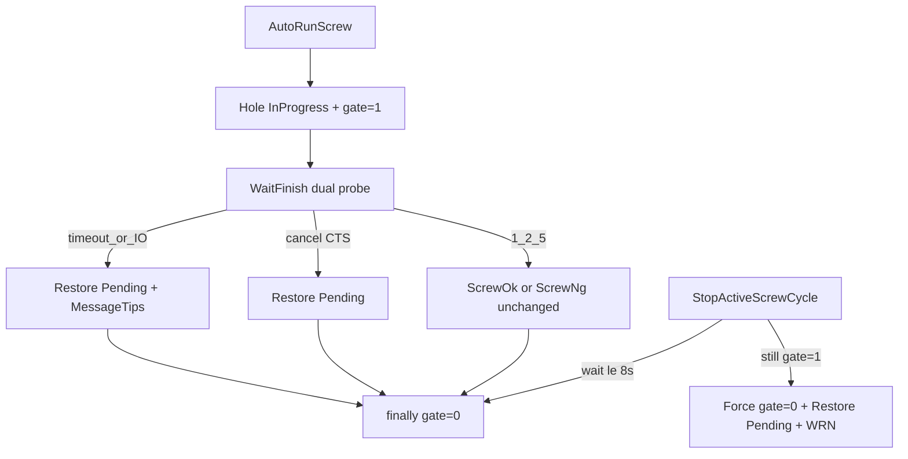

# 拧紧挂起健壮性（V1.0 最小影响）

## 发布约束（最高优先级）

V1.0 已发布上线。本改动目标是**修挂起/不响应**，不是重构。

- **最小 diff**：只动下列文件；不改 MES/追溯字段、不改默认超时 120s、不改配置 schema、不改 HMI 设备编辑器、不改问题 2。
- **成功路径不变**：设备正常给出 Finish `1|2|5` 时，仍走现有 ScrewOk / ScrewNg / `#750/#751` / 推进下一钉；不改变判定权威（设备结果优先）。
- **只扩展失败与边界路径**：超时、通信异常、取消超时门闩残留、Finish 落在另一寄存器。
- **禁止顺手清理**：无关格式化、重命名、注释大改一律不做。

## 方案结论

**同一 PR 两件事，实现顺序：先硬防护，再双址。** 只做其一都不足以同时满足「不卡死」和「尽量采到完成标志」。

操作员底线：**可以弹错，不能无反馈卡死。**

## 改动点（收紧语义）

### 1. 状态机 / 取消硬防护

[`OperatorSessionController.cs`](src/AutoScrew.Application/Services/OperatorSessionController.cs)

- `RunCurrentScrewCycleAsync`：在现有 `catch (OperationCanceledException)` 之外，增加对**其它异常**的 `RestoreInProgressScrewToPending()` + `NotifyChanged()`，然后 **rethrow**（不吞掉，避免改变调用方对失败的感知）。成功路径零改动。
- `StopActiveScrewCycleAsync`：8s 后若门闩仍为 1 → **强制**清 0 + Restore Pending + Warning（`force-cleared`）。这是把现有“只打 WRN 仍拒拧”改成可恢复；正常 ≤8s 内 finally 已清门闩时，此分支不触发。

[`MainViewModel.cs`](src/AutoScrew.Hmi/ViewModels/MainViewModel.cs) `ExecuteScrewCycleAsync`

- 仅在现有 `catch (Exception ex)` 中：保留 `StatusMessage = ex.Message`，**追加**一次 `MessageTips.ShowDialog`（与同文件其它错误提示一致）。
- 不改 `try` 成功分支、`OperationCanceledException` 文案、AutoChain、曲线 `CurveChanged` 时机。

### 2. Finish 双址探测 + 诊断（保守）

[`TighteningCycleRunner.cs`](src/UDL.Delta.IemdSd/Internal/TighteningCycleRunner.cs)

- `WaitFinishAsync`：每轮读 `0x1F5D` 与 `0x26`；任一为 `1|2|5` 即返回。
- **冲突处理（防新 bug）**：若两址同时为有效完成值且不一致，以 `UseLegacyFinishRegister` 所选主址为准并打 Warning（现场几乎不应出现；避免随机取一侧）。
- `ClearFinishAsync`：成功收口后两址均写 0（对齐供应商 Demo；**仅在现有 Clear 调用点**，轮询中不写）。
- 日志：命中时 Information（地址、值、elapsed）；轮询 Debug **节流**（约每 2s），避免刷爆 Comm 日志影响现场排查其它问题。
- 超时文案带两址末次值；不改变默认 `TighteningCycleTimeoutMs`。

**风险控制**：双读略增轮询总线负载（每 poll +1 次读），间隔仍用现有 `TighteningPollIntervalMs`，不引入新并发会话。

### 3. 明确不做

- 不缩短默认 120s；不暴露 `UseLegacyFinishRegister` 到 HMI 编辑器。
- 不做运输层硬中止；不做问题 2；不改 DATA_AND_TRACE / SPEC 验收数字。

## 验证（发布前必做）

### 自动化（改完即跑）

- 扩展 [`TighteningCycleTimeoutTests.cs`](tests/UDL.Delta.IemdSd.Tests/TighteningCycleTimeoutTests.cs)：超时仍抛；仅 `0x26=1`；仅 `0x1F5D=1`；两址冲突取主址；Clear 两侧写 0。
- 必跑既有回归（至少）：
  - `tests/UDL.Delta.IemdSd.Tests`（含 Timeout）
  - `OperatorSessionDeviceAuthorityTests`（设备 OK/NG 权威不变）
  - 能低成本加则加：cancel/异常后门闩=0 且钉位 Pending（复用现有 sim env）；加不上不阻塞，用手动清单补。

命令示例：`dotnet test` 针对上述项目/过滤，全部绿才继续。

### 手动回归清单（仿真或脱机）

1. **正常 OK**：扳机完成 → ScrewOk → 推进；日志有 Finish 命中地址。
2. **正常 NG**：设备 NG → NgLocked；解锁后可继续（既有路径）。
3. **Reset 中取消**：周期中 Reset → 钉位回 Pending → 可再次 AutoRun（无永久 in-progress）。
4. **超时/通信失败**：弹 MessageTips；钉位 Pending；可再拧（不要求真机造 120s，可用单测/缩短测选项或 mock）。
5. **ParamRead / 换页**：成功路径下行为与改前一致；周期中抢总线仍可能失败，但失败须可提示且可恢复（本 PR 不新开禁读参）。

### 合入标准

- Diff 仅含上述相关文件 + 测试 + 必要本地化键（若新增）。
- 上述自动化全绿；手动清单 1–4 通过。
- 无成功路径语义变更的代码审查关注点（OK/NG 判定、报告读取顺序、Unlock 时机）。
