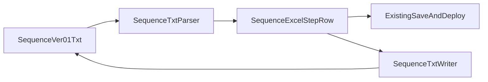

# 拧紧顺序 TXT 换用业务 Ver01 模板

## 定稿决策

- **只支持新表格式**（[`doc/protocol/拧紧顺序 Ver01.txt`](doc/protocol/拧紧顺序%20Ver01.txt)）；旧 `步骤`+`键：值` TXT **废弃**（解析遇旧格式给出明确升级提示）。
- **吸头 / 结果**：协议无字段；读写时与备注合并往返：
  - 导入：`备注` 正文 + 后缀 `[吸头:A][结果:预紧]`（有值才拼；原备注空则仅后缀）。
  - 导出：从 `Remark` 拆出 `[吸头:…][结果:…]` 写回独立列，剩余作备注列。
- **产品PN【】**：导入时若文件头有 PN，与工艺库所选 `productPn` **不一致则报错**；为空则不校验。
- **Excel**：表头与解析逻辑不变（仍无吸头/结果列）。

## 列映射

| Ver01 列 | → `SequenceExcelStepRow` |
|---|---|
| 顺序 | `Order` |
| 位置 | `Location` |
| 螺钉PN | `ScrewPn` |
| 【拧紧参数】 | `ParameterCode`（去括号） |
| 数量 | `Quantity` |
| 批头 | `BitId` |
| 吸头 + 结果 + 备注 | 合并为 `Remark`（见上） |

行形态要点：参数与数量常在同一竖线分段内（`【code】    4`），用正则 `【(?<code>[^】]+)】\s*(?<qty>\d+)` 提取，勿假定「数量」单独一列。

## 实现步骤

### 1. 重写解析 [`SequenceTxtParser.cs`](src/AutoScrew.Infrastructure/ProcessLibrary/SequenceTxtParser.cs)

- 头：`产品PN【】` / `版本号【】`（版本仅忽略或日志）。
- 跳过说明行与表头行（含 `顺序` 且含 `位置`）。
- 数据行：按全角/半角 `｜`/`|` 分段；不足列则报「第 N 行格式无效」。
- 调用现有 [`SequenceStepRowFactory.Create`](src/AutoScrew.Infrastructure/ProcessLibrary/SequenceStepRowFactory.cs)；`remark` 传入合并后字符串。
- 小工具：`SequenceRemarkMeta.Merge(remark, nozzle, result)` / `TrySplit`（建议独立静态类，Parser/Writer 共用）。
- 若全文像旧格式（存在单独一行 `步骤` 且无 Ver01 表头特征）：`InvalidDataException` 提示改用新模板。

### 2. 重写写出 [`SequenceTxtWriter.cs`](src/AutoScrew.Infrastructure/ProcessLibrary/SequenceTxtWriter.cs)

- `Format(steps, productPn = "")`：写出 Ver01 头（产品PN、版本号 00、后缀说明）+ 表头 + 每步一行。
- 从 `Remark` `TrySplit` 出吸头/结果；空列写空白。
- [`ControllerSequenceViewModel`](src/AutoScrew.Hmi/ViewModels/ControllerSequenceViewModel.cs) 导出 TXT 时传入当前工艺库/上下文产品 PN（若无则空 `【】`）。

### 3. 上传校验

[`ProcessLibraryService.UploadSequenceTxtAsync`](src/AutoScrew.Infrastructure/ProcessLibrary/ProcessLibraryService.cs)：Parse 后若解析器暴露了文件头 `ProductPn`，与入参 `productPn` 比较（可让 `SequenceExcelParseResult` 增加可选 `HeaderProductPn`，或 Parse 返回旁路 out；最小改动：Parser 返回 result 时把头 PN 放进现有结构——**扩展** `SequenceExcelParseResult` 增加 `string? SourceProductPn`）。

### 4. 测试与文档

- 用协议样例（可微调空白）作 fixture：两步解析出 Order/Location/ParameterCode/Qty/Bit；Remark 含 `[吸头:A][结果:预紧]`。
- Writer → Parser 往返保留吸头/结果与备注正文。
- 旧 `步骤` 样板应失败且文案可读。
- 更新 [`doc/PROCESS_LIBRARY.md`](doc/PROCESS_LIBRARY.md) / 手册一句：顺序 TXT 已换 Ver01；吸头/结果仅存备注。
- 废弃说明：[`doc/samples/AllTemplateSequence.txt`](doc/samples/AllTemplateSequence.txt) 改为 Ver01 样例或标注 obsolete。

## 验收

- 业务 Ver01 文件可上传工艺库并正常换产下发（设备步仍只有参数/数量/批头）。
- 导出 TXT 为表格式；再导入吸头/结果不丢（在备注标记中）。
- Excel 路径回归不受影响。
