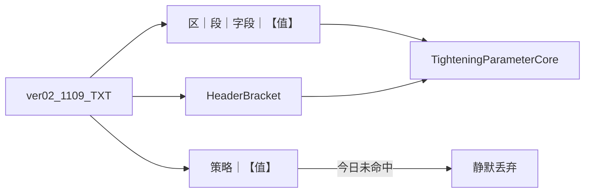

# 1109 模板对照与解析健壮性

## 对照结论

| 文件 | vs 仓库旧样板 | 对解析器影响 |
|---|---|---|
| [拧紧参数--模板ver02 1  1109.txt](doc/protocol/拧紧参数--模板ver02%201%20%201109.txt) | **仅新增**一行 `策略｜【     】 标准/加强/预定位/自创/` | **高**：非四段 `区｜段｜字段｜【值】`，现有 `DataRow` 不匹配 → 策略被静默忽略 |
| [产品锁附模板 Ver01 1 1109.txt](doc/protocol/产品锁附模板%20Ver01%201%201109.txt) | 与 [拧紧顺序 Ver01.txt](doc/protocol/拧紧顺序%20Ver01.txt) **内容一致** | 格式无变；仍走 [SequenceTxtParser](src/AutoScrew.Infrastructure/ProcessLibrary/SequenceTxtParser.cs) |

参数卡其余行与旧 ver02 / Writer 对齐；已知缺口在 1109 上仍成立。

## 必须修的正确性缺口（参数卡）

### 1. 解析 `策略｜【…】`（1109 新行）

文件：[ProcessCardVer02Parser.cs](src/AutoScrew.Infrastructure/ProcessLibrary/ProcessCardVer02Parser.cs)

- 增加专用匹配（在 `DataRow` 之外）：`^策略\s*[｜|]\s*[【\[】\]]`
- 填入 `global["策略"]`；空值仍走现有 `InferFromStages`
- Writer [ProcessCardTxtWriterVer02.cs](src/AutoScrew.Infrastructure/ProcessLibrary/ProcessCardTxtWriterVer02.cs)：在「拧紧参数后缀」后写出同形策略行（`标准/加强/预定位/自创`），与业务模板一致

### 2. 「最终电流判定」看尾注

模板与 Writer 均为：`进阶设定｜【0/1】 最终电流判定 | F2…`

- `ApplyGlobalRow`：与「供料结果延时」一样，`field` 或 `tail` 含「最终电流判定」即写入
- 单测：尾注带「最终电流判定」且值为 `1` → `FinalCurrentJudgeEnabled == true`

### 3. 自创段「阶段5 / 阶段6」

- `MapStageIndex`：`seg` 含「阶段5」→ 4，「阶段6」→ 5（与 Writer `SegNames` 一致）
- 单测：写出含槽 4/5 的自创卡再读回，策略与段内容保留

## 健壮性与样板同步

- 将 1109 参数卡、产品锁附卡复制为测试 fixture（或直接 `doc/protocol` 相对路径读入），覆盖：
  - 空白样板可解析（后缀空时依赖文件名槽位；fixture 命名 `*_00.txt`）
  - 填入 `策略｜【加强】` 后 `Strategy == Enhanced`
  - 顺序 1109 两步：参数码、数量、批头、吸头/结果备注标记
- 更新权威样板：用 1109 内容覆盖/对齐 [拧紧参数--模板ver02.txt](doc/protocol/拧紧参数--模板ver02.txt)（补上策略行）；顺序侧保持 `拧紧顺序 Ver01.txt` 与产品锁附同文即可
- [doc/PROCESS_LIBRARY.md](doc/PROCESS_LIBRARY.md) §3：补 ver02 行格式 + 策略行；§4 注明「产品锁附模板」= 顺序 Ver01 同构
- [doc/Help/UserManul.md](doc/Help/UserManul.md) 工艺卡一句：策略行、`最终电流判定` 在尾注

不扩大范围：不改顺序上传丢备注/位置的产品行为；不加 CorrelationId；不改扭矩单位约定（仍 lbf.in）。

## 验收

- 解析官方 1109 参数空白卡不抛（文件名带槽位）
- `策略｜【加强】` / 最终电流判定尾注 `1` / 阶段5–6 往返正确
- 产品锁附 1109 fixture 与现有 `SequenceTxtParser` 断言通过
- 现有 `ProcessCardTxt*` / `SequenceTxt*` 回归全绿
