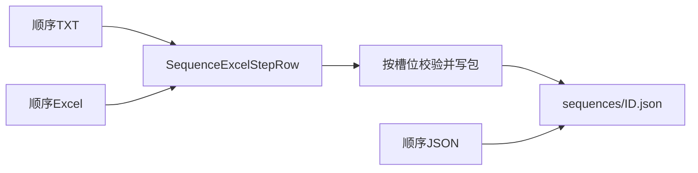

# 拧紧顺序 TXT 导入

工艺库顺序今天有两条导入：JSON 直接反序列化成 `TighteningSequencePackage`；Excel 经 [SequenceExcelParser.cs](src/AutoScrew.Infrastructure/ProcessLibrary/SequenceExcelParser.cs) 得到步骤行，再由 [ProcessLibraryService.UploadSequenceExcelAsync](src/AutoScrew.Infrastructure/ProcessLibrary/ProcessLibraryService.cs) 按「螺钉PN-槽位」对上已上传工艺卡，写成 `sequences/{id:D2}.json`。TXT 只增加一种**填写格式**，落盘和进设备的步骤与 Excel 相同。

进设备的只有三列：`拧紧参数` → `ParameterId = 槽位+1`，`数量`，`批头`（`ToolId` 固定 0）。`位置`、`备注` 仍只做人读，不进包。顺序 ID 仍用工艺库页现有输入框（1–500），显示名仍取文件名（不含扩展名）。导航坐标、定位臂、工具号继续只走 JSON。



## 模板

样板放到 [doc/samples/AllTemplateSequence.txt](doc/samples/AllTemplateSequence.txt)，与 [doc/samples/AllTemplateParams.txt](doc/samples/AllTemplateParams.txt) 成对。规则与参数卡相同：`#` / `//` 注释，行尾 `<说明>` 忽略，键可用全角或半角冒号。每个 `步骤` 一块；块内必填 `拧紧顺序`、`拧紧参数`、`数量`、`批头`，`螺钉PN` / `位置` / `备注` 可省略。

```text
# 顺序 ID 在工艺库页填写，不写在本文件。位置、备注不进设备。
# 拧紧参数 = 已上传工艺卡的「螺钉PN-槽位」。槽位 00 → 设备参数 ID 1。

步骤
拧紧顺序：1                 <从 1 起；可乱序，导入后按此排序>
位置：pump1锁附              <人读，不进设备>
螺钉PN：ALLTPL               <须与拧紧参数前缀一致；省略则用参数码前缀>
拧紧参数：ALLTPL-00
数量：4                      <1–999999>
批头：1                      <0–255>
备注：预紧                   <可省略>

步骤
拧紧顺序：2
位置：pump1锁附
螺钉PN：ALLTPL
拧紧参数：ALLTPL-01
数量：4
批头：1
```

校验与 Excel 共用，避免两套规则漂移：抽出 `SequenceStepRowFactory`，Excel 的 `ParseDataRow` 与 TXT 都调用它。不一致、数量、批头的报错文案保持现有 Excel 原文。TXT 把 `步骤` 所在行号写入 `SequenceExcelStepRow.ExcelRowNumber`，上传失败时仍是「第 N 行：…」。按 `拧紧顺序` 再按行号排序，与 Excel 相同。

## 代码

- 新增 [SequenceTxtParser.cs](src/AutoScrew.Infrastructure/ProcessLibrary/SequenceTxtParser.cs)：`Parse` / `ParseFile` → 现有 `SequenceExcelParseResult`。
- 新增 [SequenceTxtWriter.cs](src/AutoScrew.Infrastructure/ProcessLibrary/SequenceTxtWriter.cs)：步骤行写回上述键值块，供顺序页导出和往返测试。
- [ProcessLibraryService.cs](src/AutoScrew.Infrastructure/ProcessLibrary/ProcessLibraryService.cs)：把 `UploadSequenceExcelAsync` 里「校验槽位 → 组 `TighteningSequenceStepCore` → `SaveSequenceAsync`」抽成共用方法；新增 `UploadSequenceTxtAsync`，只是先走 TXT 解析。JSON 的 `UploadSequenceAsync` 不动。
- [IProcessLibraryService.cs](src/AutoScrew.Application/Abstractions/IProcessLibraryService.cs) 增加解析与上传 TXT 的方法。
- 工艺库页 [ProcessLibraryPage.xaml](src/AutoScrew.Hmi/Views/Pages/ProcessLibraryPage.xaml) 在「上传顺序 Excel」旁加「上传顺序 TXT」，复用同一个顺序 ID 框；筛选 `*.txt`，单文件。[ProcessLibraryViewModel.cs](src/AutoScrew.Hmi/ViewModels/ProcessLibraryViewModel.cs) 对齐现有 Excel 上传的忙状态、审计和错误提示。
- 顺序编辑页在「导出顺序 Excel」旁加「导出顺序 TXT」。行数据继续用现有导出逻辑（默认螺钉 PN、位置列写法）；对话框标题按导出类型切换，保存为 `sequence-{id:D2}.txt`。
- 文案：[Strings.zh-CN.xaml](src/AutoScrew.Hmi/Themes/Strings.zh-CN.xaml) 与 [Strings.en-US.xaml](src/AutoScrew.Hmi/Themes/Strings.en-US.xaml) 成对增加按钮和状态句，并改工艺库说明里「顺序只有 JSON」的那句。
- 契约：[doc/PROCESS_LIBRARY.md](doc/PROCESS_LIBRARY.md) 第 4 节改为 JSON / TXT / Excel，链到样板；[doc/Help/UserManul.md](doc/Help/UserManul.md) 上传顺序那一行补上 TXT。

库内顺序文件仍是 JSON。TXT 只在导入、导出时出现，和 Excel 一样。

## 测试

在 [tests/AutoScrew.Tests](tests/AutoScrew.Tests) 增加 `SequenceTxtParserTests`，对照现有 [SequenceExcelParserTests.cs](tests/AutoScrew.Tests/SequenceExcelParserTests.cs)：

- 两步样例解析出槽位 00/01、数量、备注；乱序按拧紧顺序重排
- 螺钉 PN 与参数码前缀不一致报错
- 缺「数量」报错；`<说明>` 与 `#` 不进字段
- 工艺库缺槽位时上传异常含行号；槽位齐全时包内 `ParameterId` 为 1、2，显示名为文件名
- Writer 写出后再解析，步骤与原文一致

跑 `dotnet test tests/AutoScrew.Tests --filter SequenceTxt`。
